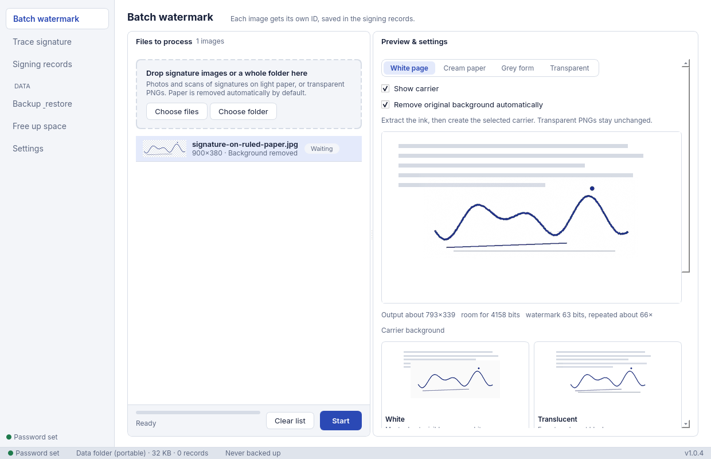
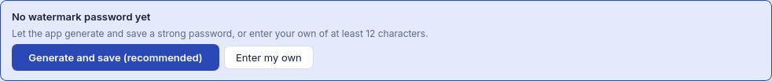

# SigWatermark

[English](README.md) · [简体中文](README.zh-CN.md) · [繁體中文](README.zh-TW.md) · [日本語](https://github.com/LE-saber/signature-watermark/blob/main/README.ja.md)

日文指南提供在线版本。既有 v1.0.4 压缩包仍包含原先三种 README，本次文档修改不会重新构建发行附件。

[](https://github.com/LE-saber/signature-watermark/actions/workflows/build.yml)
[](https://github.com/LE-saber/signature-watermark/releases/latest)

把签名照片处理为半透明、羽化等样式的电子签名，嵌入隐形 ID，并从 PDF、Word、图片和扫描件追查签发记录的便携桌面工具。

每次签发使用不同的 ID 和用途，日后发现签名出现在其他文件中，就可以尝试追查对应的签发记录。主程序的图像处理和记录保存在本机。



## 1.0.4 更新

- 新增横格线、方格线、表格线、照片边缘杂物和纸面纹理清理，尽量保留交叉笔画、签名下划线和点。
- 默认载体不透明度从 96 降到 24/255（约 9%）；溯源新增纸色补偿，以及签名压住印刷文字时的形状定位。
- 首次启动支持随机生成并保存密码，设置页增加随机生成和复制。
- 水印格式仍为 `SIG-BLIND-WM-2`，旧图片仍需要原密码和签发记录。



升级前请备份记录、输出图片和密码。旧设置中的不透明度 96 会迁移为 24，包括手动选为 96 的情况；其他值保留。形状定位依赖记录路径下的输出 PNG，清理数据时请保留输出图片。参见[验证结果与限制（英文）](docs/VALIDATION.md)，其中包含实测性能取舍。

## 下载

从 [Releases](https://github.com/LE-saber/signature-watermark/releases/latest) 下载**便携应用压缩包**。GitHub 自动生成的 “Source code” 是源码包，需要自行配置 Python 环境。

| 平台 | 1.0.4 版本 | 解压后启动 |
| --- | --- | --- |
| Windows x64 | [ZIP](https://github.com/LE-saber/signature-watermark/releases/download/v1.0.4/SigWatermark-1.0.4-windows-x64.zip) | `SigWatermark/SigWatermark.exe` |
| macOS Apple Silicon | [ZIP](https://github.com/LE-saber/signature-watermark/releases/download/v1.0.4/SigWatermark-1.0.4-macos-arm64.zip) | `SigWatermark.app` |
| macOS Intel | [ZIP](https://github.com/LE-saber/signature-watermark/releases/download/v1.0.4/SigWatermark-1.0.4-macos-x64.zip) | `SigWatermark.app` |
| Linux x64 | [tar.gz](https://github.com/LE-saber/signature-watermark/releases/download/v1.0.4/SigWatermark-1.0.4-linux-x64.tar.gz) | `./SigWatermark/SigWatermark` |

无需另外安装 Python。请完整解压，保留程序与配套文件。每个压缩包均附带英文快速说明和三种语言的 README。校验值见 [`SHA256SUMS.txt`](https://github.com/LE-saber/signature-watermark/releases/download/v1.0.4/SHA256SUMS.txt)。

Windows 包未代码签名；macOS 包未签名、公证，首次启动可能需要在系统安全设置中批准。macOS 包在 macOS 15 原生环境构建。Linux 包在 Ubuntu 22.04 构建，需要桌面环境。Debian/Ubuntu 如缺少 Qt/xcb 运行库，可安装：

```bash
sudo apt-get install libegl1 libxkbcommon-x11-0 libxcb-cursor0 libxcb-icccm4 libxcb-keysyms1 libxcb-shape0 libxcb-xinerama0 libxcb-randr0 libxcb-render-util0 libxcb-image0 libdbus-1-3
```

## 快速开始

1. 打开程序，在“设置”中点 **随机生成并保存**，让程序生成高强度密码；也可以自己输入**至少 12 个字符**的密码。
2. 在“批量加水印”中添加白纸、浅色纸上的签名照片、扫描图或文件夹。“自动去除原图背景”默认开启，已有透明笔迹 PNG 保留原样。
3. 填写用途，选择载体样式，预览并生成水印 PNG。浅色笔迹可提高“笔迹保留阈值”；需要保留原设计时可关闭自动去背景。每张图片都有独立 ID 和签发记录。
4. 将生成的 PNG 用于文件。日后在“签名溯源”中添加 PDF、Word、图片或扫描件进行查询；自动检测不准时可手动框选签名区域。
5. 更换电脑或清理文件前，备份签发记录和水印密码。

仓库 README 默认英文。程序界面默认跟随系统语言，支持英文、简体中文、繁体中文、日文、韩文、法文、西班牙文、俄文和阿拉伯文。在设置中切换语言，重启后生效；阿拉伯文使用从右到左的布局。

## 功能

- 批量处理、拖入文件或文件夹、用途标签、自定义输出名称、预览和可选的回提自检。
- 内置去纸张背景、浅色纸和渐变阴影校正、笔迹保留阈值调节、相机方向校正。
- 四种替换载体：白底、半透明、羽化、羽化加淡纹理。修改处理参数后，已完成图片会重新进入队列，便于再次导出。
- 从 PDF 内嵌图片、Word `.docx`/`.docm` 媒体图片、普通图片、照片和扫描件中溯源，支持尺寸恢复与手动选区。
- 本地签发记录搜索、时间记录、源文件和输出文件的 SHA-256、图像几何信息及 CSV 导出。
- `.swbak` 选择性备份恢复、可选 AES-256 加密、备份历史和提醒。
- 空间统计与清理，可只删除已备份文件，保留签发记录。
- 图形界面和命令行；主程序无需服务器。

## 实现原理

先提取笔迹，再生成载体。预览和导出使用相同的预处理流程，紧贴笔迹的裁剪图也会补足所选留白。顶部的纸张按钮只切换预览底色，导出 PNG 的背景由载体样式决定。

图片只携带类似 `W1234ABC` 的短 ID，编码后为 63 位水印。用途等完整信息保存在 SQLite，通过 ID 关联查询。

自带内核使用 NumPy 改写 `blind_watermark 0.4.4`：YUV 转换 → Haar 小波变换 → 低频部分分为 4×4 小块 → DCT → 密码派生的系数重排 → SVD 量化。比特在多个块、多个通道中重复写入；提取时解除重排并汇总结果，不需要原始无水印图片。

当前格式为 `SIG-BLIND-WM-2`。新版先在“合成到白纸上的显示效果”中嵌入，再反算 RGB 并保留透明通道，减轻半透明图片叠入文件后水印变弱的问题。提取时也尝试原始 RGB，以兼容旧图。

扫描图先检测墨迹区域，再结合记录中的签名边界还原载体。63 位编码中有 49 个位置能区分不同 ID：至少 46 位一致判为匹配；43–45 位一致且明显领先其他记录时可判为可能匹配。这些阈值不是准确率。

## 数据与密码

默认在程序旁的 `data/` 中保存数据；目录无法写入时，使用系统用户数据目录。实际位置见设置。切换存储模式在重启后生效，不会自动搬移原数据。

| 内容 | 存储位置 |
| --- | --- |
| 设置 | `settings.json` |
| 签发记录、文件追踪 | `records.sqlite` |
| 原图副本 | `uploads/` |
| 水印图片 | 默认 `out/`，可修改 |
| 通过溯源界面导入的文件 | `docs/` |
| 缓存、备份 | `cache/`、`backup/` |

密码优先存入系统钥匙串；不可用时回退至 `settings.json`，请妥善保管数据目录。备份中包含水印密码时，必须启用加密。应保留原密码和记录：更换密码不会重新处理旧图片，只有 ID 也无法恢复用途和签发历史。

## 命令行

先在图形界面设置密码。在解压目录中打开 Windows PowerShell：

```powershell
.\SigWatermark\SigWatermark.exe embed .\signatures --purpose "合同 A" --mode feathered_texture
.\SigWatermark\SigWatermark.exe trace .\contract.pdf .\document.docx .\scan.jpg
.\SigWatermark\SigWatermark.exe --data-dir .\alternate-data embed .\signature.png --out .\output
```

启动诊断可运行程序并附加 `--gui-smoke-test <空文件夹>`；程序检查六个页面后写入 `gui-smoke.json` 并退出。

浅色笔迹可增加 `--background-threshold 245`。`--no-remove-background` 保留原背景，`--remove-background` 显式开启去背景。

Linux 使用 `./SigWatermark/SigWatermark`，macOS 使用 `./SigWatermark.app/Contents/MacOS/SigWatermark`，参数相同。`--data-dir` 必须放在子命令之前。模式可选 `white`、`translucent`、`feathered`、`feathered_texture`。

## 使用限制

- 自动去背景适用于纸上的局部签名图。横格纸、方格纸、表格线（包括被笔画穿过的地方）、边缘的桌面或阴影、光照不均和粗糙纸面会尝试自动清理，复杂输入仍可能需要手动修整。签名旁边的其他手写内容不会去除，请先裁掉。载体默认不透明度为 24/255（约 9%），下面的文字清晰可见；溯源会补偿有色纸张，并能找到紧贴印刷文字的签名。

- 低不透明度签名压在正文上时，仍可能只得到“可能匹配”；不同水印 ID 和载体纹理的恢复表现会有差异。请保留输出原图，结果不确定时检查原文件。
- 恢复依赖水印信号和对齐。强压缩、大幅缩放、裁剪、旋转、透视变形及低质量打印扫描都可能导致失败。部分样本缩小到 50% 后恢复尺寸仍能提取，不代表所有图片都能达到相同效果。
- 半透明载体适合白色或浅色背景；照片溯源未做透视校正。
- 自动 PDF 分析主要检查内嵌图片，没有对所有渲染页进行兜底扫描。Word 结果按媒体图片编号，并非真实页码；不支持旧 `.doc` 格式。
- 水印用于签发溯源，不能阻止复制、验证签署人身份或保证整份文件未被修改。
- 自动鲁棒性检查针对自带样本，覆盖合成白底、缩小至 75%/50% 后恢复尺寸、JPEG 质量 90，不能据此得出通用恢复率。

## 开发

CI 使用 Python 3.12。Windows：

```powershell
python -m venv .venv
.\.venv\Scripts\python.exe -m pip install -r requirements-dev.txt
.\.venv\Scripts\python.exe -m pip install --no-deps blind-watermark==0.4.4
.\.venv\Scripts\python.exe -m pytest -q tests
.\.venv\Scripts\python.exe app.py
.\.venv\Scripts\python.exe packaging/build.py
```

macOS/Linux 用 `python3 -m venv .venv` 创建环境，然后以 `.venv/bin/python` 执行相同命令。Linux 打包需要前述 Qt 库和 `binutils`。

PyInstaller 只能构建当前系统与架构。`packaging/build.py` 会重建 `build/` 和 `dist/`，压缩包输出到 `dist/`。推送 `v*` 标签后，自动运行四种目标平台的原生测试、构建和隔离环境下的图形界面启动检查，全部成功后生成校验值并发布 Release。

界面翻译维护在 `tools/i18n/table*.py`。修改界面文字后补充译文，再运行 `python tools/i18n/build.py`；脚本和测试会检查译文覆盖及占位符。

## 源码结构

| 路径 | 职责 |
| --- | --- |
| `app.py` | 图形界面、命令行入口 |
| `sigwm/background.py` | 使用 NumPy、Pillow 去除纸张背景 |
| `sigwm/core.py`、`sigwm/vendor/bwm/` | 载体、嵌入、提取、鲁棒性检查 |
| `sigwm/imgops.py`、`sigwm/trace.py` | 图像运算、文件解析、定位和匹配 |
| `sigwm/service.py`、`sigwm/storage.py` | 批处理、设置、SQLite 和文件追踪 |
| `sigwm/backup.py`、`sigwm/secret.py` | 备份恢复和密码保存 |
| `sigwm/gui/`、`sigwm/i18n.py`、`sigwm/locales/` | 桌面界面、多语言 |
| `packaging/`、`.github/workflows/build.yml` | 原生便携包和版本发布 |
| `tests/` | 内核、溯源、数据、图像运算和翻译测试 |
| `tools/signature-remove-bg/` | 独立去背景 Web 工具，依赖单独安装 |

旧版 Python、批处理、PowerShell 和 OpenStego 文件均保留，可在设置中导入旧签发记录。旧记录没有签名边界，不能用于自动页面定位。

## 第三方组件

水印内核改写自 [guofei9987/blind_watermark](https://github.com/guofei9987/blind_watermark)，采用 MIT 许可，全文见 `sigwm/vendor/bwm/LICENSE`。附带的 Inter、IBM Plex Mono 和 Noto 字体采用 SIL OFL，许可随字体及便携包提供。macOS 调用系统已有界面字体。独立去背景工具附带自己的许可和依赖说明。
